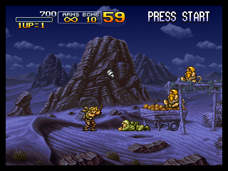
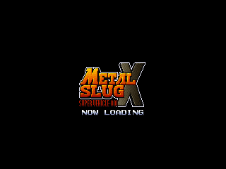

# PS1Play — an AI agent that plays PS1 games by reading RAM

<p align="center">
  
</p>

<p align="center">
  <b>Metal Slug X (SLUS-01212)</b> running fully headless on a libretro core,<br>
  played by a zero-token agent that <b>never looks at pixels</b> — it reads the emulated 2&nbsp;MB RAM as numpy arrays.
</p>

---

## What is this?

**PS1Play** is a plugin-based, agentic framework that boots PlayStation 1 games with
**no GPU, no X11, no window** — a pure-Python (ctypes) libretro frontend runs the
Beetle PSX core at **~110–400 fps** with software rendering — and then plays the game
**like a human**: it only injects pad buttons, and it *perceives* the game entirely
through **RAM bytes**.

Three hard design rules make it different from typical "AI plays games" demos:

1. **Zero pixels for decisions.** Screenshots are saved as evidence for humans only.
   The agent's perception is numpy analysis of the live 2 MB main RAM — the same
   information a GameShark sees, used for *reading*, not cheating.
2. **Zero LLM tokens at runtime.** No vision model, no language model in the loop.
   Discovery, world-modelling and the policy are classical algorithms (numpy).
3. **Legal inputs only.** During real runs the agent never writes a byte of game
   memory, never rewinds. Savestates are used only for read-only calibration probes
   and checkpoints. (A full GameShark engine exists as an opt-in assist and is
   verified with event proofs.)

## How it works

```
                        ┌──────────────────────────────────────────────┐
                        │                libretro core                 │
                        │        (Beetle PSX, software renderer)       │
                        └───────────────┬──────────────────────────────┘
                                        │  ctypes frontend (core/host.py)
             button injection           │              live 2 MB RAM view (numpy)
        ┌──────────────────────────────►│◄──────────────────────────────┐
        │                               │                               │
┌───────┴────────┐              ┌───────▼────────┐              ┌───────▼────────┐
│   policy.py    │              │  worldmodel.py │              │ perception.py  │
│ dodge > shoot  │              │ discovers entity│             │ event-verified │
│ > grenade >    │              │ slots (enemy / │              │ anchors (bombs │
│ heal > loot >  │              │ bullet / item) │              │ -1 per grenade)│
│ advance        │              │ from behaviour │              │ + freeze tests │
└────────────────┘              └────────────────┘              └────────────────┘
        │                               ▲                               ▲
        └────────────── semantic scene ─┴─────── GameShark-grade seeds ─┘
                                       (agent/gsmap.py — read-only)
```

**The pipeline, end to end:**

| Stage | Module | What happens |
|---|---|---|
| Boot | `core/host.py` | ctypes libretro frontend: software XRGB8888 rendering, joypad injection, live RAM/VRAM numpy views, savestates |
| Enter | `api.py` `enter_gameplay3` | Adaptive menu navigation with a 64×48 thumbnail classifier + input-responsiveness gates; **control is proven** by trajectory divergence (3 input scripts from one savestate must produce different RAM futures — attract demos can't fake it) |
| Perceive | `agent/perception.py` | Finds the *dynamic* gameplay cluster each boot via event-verified anchors (bombs counter: exactly −1 per grenade, twice) and translates the whole hp/ammo/lives cluster by delta; player HP found by freeze-test |
| Model | `agent/worldmodel.py` | Discovers entity tables live from behaviour: words that move *without* input = enemies, fast movers = bullets, static-until-touched = items |
| Decide | `agent/policy.py` | Human-priority rule base: dodge bullets → shoot nearest → grenade clusters → eat health → loot → advance with hop cadence and tap-fire rhythm |
| Learn | `agent/discovery.py`, `memscan.py` | RetroArch-style read-only cheat finder + bidirectional probes build a per-game **profile** once, reused forever |
| Assist | `agent/gameshark.py` | Full PSX PAR/GS engine: parse `8x/3x/D0/A0`, apply per frame (hardware behaviour), **verify with event proofs**, revision-check published patches |
| Resume | `core/statemgr.py` | Savestates + JSONL journal → "continue from where you left off", even in a fresh process |

## Static reverse engineering (`ps1play/re/`)

The game itself was treated as source code. `scripts/extract_exe.py` pulls the
PS-X EXE from the .bin, `static_re.py` disassembles it with capstone and builds a
2384+ entry xref map, `dump_asm.py` dumps the real functions (`re/asm_*.asm`):

- `SLUS_012.12`: 606 KB PS-X EXE @ `0x80010000`, entry `0x80082A44`
- **Pad array @ `0x800D4948`** (16 code xrefs) — the "are we in control" gate
- **Score P1 @ `0x800EE318`** (9 xrefs), **POW @ `0x80087A78`** (4 xrefs)
- The gameplay cluster (hp/ammo/bombs/lives/timer) is **dynamically placed** — it
  moves every boot and every mission reload, which is exactly why published
  GameShark addresses don't work on this dump; the internal layout matches them,
  so one event-verified anchor + a per-instance delta translates the cluster
- Runtime overlays (`ENEMY.BIN`, `MISSION.BIN`…) are extracted from the ISO and
  located verbatim in live RAM by pattern match

## Results so far

**v0.5 — legit run, no cheats, no memory writes, no rewinds**
(`download/ps1play_v4_mission1/mission1_report.json` + PNG evidence):

- Boot → adaptive menu navigation → Mission 1, fully headless
- 45,000 frames @ 113 fps, **27 kills registered on the real score counter**
- 18 continues survived; bot reliably crosses **canyon → market → village
  (~35% of Mission 1)** every life
- 17 policy iterations root-caused 6 distinct blockers (noisy entity slots,
  1-frame jump taps, keepalive false-positives during pause, attract-demo
  self-play mirroring, scenery-truck landing…) — all documented in the report

**v0.4 — GS-assist session**: 27,000 frames @ 215 fps, 25 × +100 kills on the
static score address, Invincible + Infinite Bombs freeze codes re-anchored and
re-verified after every mission reload.

<p align="center">
  <br>
  <sub>death-detection evidence: the agent senses death from RAM (lives −1) and recovers</sub>
</p>

## Run it

```bash
python3 scripts/run_mission1_legit.py            # legit Mission-1 run (no cheats)
python3 scripts/run_semantic2.py                 # GS-assist semantic session
SEM_ASSIST=0 python3 scripts/run_semantic2.py    # same, assist disabled
python3 scripts/verify_gs_live3.py               # GameShark verification chain
python3 scripts/static_re.py                     # rebuild the xref/source map
python3 scripts/ps1play_demo.py                  # 35-second end-to-end demo
```

**Requirements** (not included — you must own them):

- Python 3.10+, numpy, Pillow
- Beetle PSX libretro core (`mednafen_psx_libretro.so`)
- SCPH-5501 BIOS (SHA1 `0555c6fa…88e9f30b`) — Beetle rejects other revisions
- Your own `Metal Slug X (USA)` .cue/.bin (SLUS-01212)

Paths are configured at the top of `ps1play/api.py` (`DEFAULT_CORE`,
`DEFAULT_WORKSPACE`).

## Repository layout

```
ps1play/               the framework
  core/                host (libretro ctypes), memory tools, savestates, input map
  agent/               perception, worldmodel, policy, discovery, gameshark,
                       memscan, nav (thumb classifier), gsmap (published codes)
  plugins/             universal base + Metal Slug X plugin
  profiles/            learned per-game profile + nav reference thumbnails
  re/                  static RE artifacts (extracted EXE, overlays, asm dumps)
scripts/               runners, RE tooling, diagnostics, packaging
download/              evidence: mission-1 report + gameplay/death frame captures
docs/                  demo GIFs
archive/               v0.3 source snapshot
worklog.md             full development diary (Persian) — every dead end included
```

## Honest limitations

- **Mission 1 is not reliably cleared yet.** The policy still dies in the village
  bomber-chopper + soldier-truck section: every tactic wins in the savestate lab
  (`scripts/zone_lab.py`), sustaining them live is the next iteration.
- Entity-slot classification is heuristic; the static entity-table layout from
  `ENEMY.BIN` disassembly will make it exact.
- Action buttons (Y/A/B) map to a different pad word than the D-pad; locating it
  the same way (probe + disasm around `0x80015714`) is future work.

## Adding a new game

Implement one plugin class (boot script / features / policy) in `ps1play/plugins/`,
add a nav-refs folder if the menus need thumbnails, and let one discovery run build
the profile. Boot, memory tools, savestates, journaling and the agent loop are
universal.

---

## خلاصهٔ فارسی

**PS1Play** یک فریم‌ورک ایجنتی است که بازی‌های PlayStation 1 را **بدون گرافیک**
روی هستهٔ libretro اجرا می‌کند (رندر نرم‌افزاری، ~۱۱۰ تا ۴۰۰ فریم بر ثانیه) و یک
ایجنت هوشمند آن را مثل یک انسان بازی می‌کند: فقط دکمه تزریق می‌کند و **به‌جای
دیدن پیکسل‌ها، بایت‌های رم را تحلیل می‌کند** — بدون حتی یک توکن LLM در حلقهٔ بازی.

- ادراک از رم با لنگرهای رویداد-تأییدشده (مثل شمارندهٔ نارنجک که دقیقاً −۱ می‌شود)
- کشف زندهٔ جدول دشمن‌ها/گلوله‌ها/آیتم‌ها از رفتار حافظه (بدون آدرس ثابت)
- مهندسی معکوس استاتیک واقعی بازی با capstone (`ps1play/re/`)
- موتور کامل GameShark با اثبات رویدادی (فقط حالت کمکی، اختیاری)
- ذخیره‌حالت + ژورنال → ادامهٔ بازی از هر نقطه، حتی در پروسهٔ جدید

نتیجهٔ فعلی (بدون تقلب): عبور پایدار از حدود ۳۵٪ مأموریت ۱ بازی Metal Slug X با
۲۷ کش ثبت‌شده روی شمارندهٔ امتیاز واقعی بازی. شرح کامل سفر توسعه در `worklog.md`.
